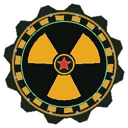

# ☢ БУНКЕР «ЗАСЛОН-19»: ПЕПЕЛ УРАЛА (v1.0.0)

**3D + 2D игра про выживание человечества в подземном бункере в России после глобального ядерного удара.**

<p align="center">
  
</p>

---

## 📥 Скачать игру (Windows .EXE Релиз)

Готовый релиз для Windows доступен в разделе **[Releases (Релизы)](../../releases)**:
- **`Zaslon19_Bunker.exe`** — Автономный 64-битный исполняемый файл для Windows 10/11 с **кастомной рамкой окна в стиле бункера** (без стандартного белого заголовка Windows, со стилизованными кнопками Свернуть `[ — ]`, Развернуть `[ □ ]`, Закрыть `[ ✕ ]` и перетаскиванием окна) и вшитой иконкой игры.
- **`Zaslon19_Nuclear_Shelter_Win64_v1.0.0.zip`** — Полный портативный архив игры (`Zaslon19_Bunker.exe`, `WebView2Loader.dll`, `Zaslon19_Standalone.html`, `icon.ico`, инструкция).

---

## 🎬 Завязка сюжета и начальная кат-сцена

При нажатии **«НАЧАТЬ ИГРУ»** в главном меню запускается кинематографическая кат-сцена (5 эпизодов со звуковым сопровождением сирен ГО, радара СПРН «Воронеж-ДМ» и ядерного взрыва):
1. **Что произошло:** 14 октября в 04:17 МСК глобальный кризис перерос в полномасштабный термоядерный конфликт.
2. **Кто ударил:** Объединённое стратегическое командование западной коалиции (NORAD / НАТО) инициировало обезоруживающий удар *«Operation Cinder Dawn»* (1 840 боевых блоков W88 и B83 из шахт Северной Дакоты и с подлодок в Баренцевом и Норвежском морях), на что система **«Периметр»** и РВСН РФ ответили встречным залпом.
3. **Сколько выжило:** Из 8,12 млрд жителей Земли в первые часы погибло почти 7 млрд. В России из 146 млн человек в глубоких подземных убежищах («Ямантау», спецметро, сеть «Заслон») успели укрыться лишь **142 380 человек**, а в уральский бункер **«Заслон-19»** до герметизации ствола спустились только **34 человека**.
4. **Боеголовка летит прямо на героя:** Разделяющийся термоядерный блок **W88 (475 кт)** падает со скоростью 7,2 км/с прямо на координаты входного ствола шахты «Заслон-19», где находится главный герой — **Артём Волков (мужчина, 28 лет, старший техник-инженер РХБЗ)**. За 4 секунды до вспышки Артём успевает вбежать в тамбур-шлюз!

---

## 🕹️ Управление (3D + 2D Гибрид)

- **`W, A, S, D`** — Передвижение в 3D (по отсекам бункера и по поверхности)
- **`Shift`** — Бег | **`Пробел`** — Прыжок
- **`Мышь`** — Осмотр в 3D и прицеливание | **`ЛКМ`** — Стрельба / Удар в ближнем бою
- **`R`** — Перезарядка текущего оружия
- **`E`** — Взаимодействие: открыть/закрыть гермодвери, подобрать лут и реликвии, говорить с НПС, использовать верстак, выйти через шлюз на улицу
- **`G`** — Надеть / снять противогаз
- **`F`** — Быстрая замена фильтра противогаза (ФГП-130)
- **`I` / `Tab`** — Инвентарь, Костюмы, Оружие и Патроны
- **`C`** — Верстак: Крафт, Ремонт снаряжения и реставрация «Старины»
- **`N`** — Системы жизнеобеспечения бункера и выжившие НПС
- **`M`** — Тактическая карта сектора с «Туманом войны»
- **`J` / `H`** — Сюжетные главы (1–5), Бестиарий мутантов и подсказки
- **`1` – `5`** — Быстрые слоты (Монтировка, Огнестрельное оружие, Аптечка, Еда, Вода)

---

## ⚙️ Ключевые механики

### 1. Выживание: Еда, Вода, Холод, Жар, Радиация и Противогазы
- **Еда и Вода:** Армейская тушёнка ГОСТ, сухпайки ИРП-Б, горячая грибная похлёбка, ржаные сухари, фляги чистой и талой радиоактивной воды, горячий хвойный чай в термосе.
- **Холод и Жар (Терморегуляция 36.6°C):**
  - На улице царит ядерная зима (**-28°C**): без тёплого бушлата/костюма или костров температура тела падает (переохлаждение / гипотермия).
  - В бункере при поломке котла отопления **КВ-19** или на поверхности у термального разлома **«Жар-Котёл» (+62°C)** возникает опасный **ЖАР / ПЕРЕГРЕВ** (сбивается крио-пакетами «Холод-М», водой и ремонтом котла), а при остановке дизель-генератора бункер промерзает до **+2°C**!
- **Противогазы и фильтры:** ГП-5, военный ПМК-3 «Сталкер» и изолирующий аппарат ИП-4М с заменяемыми угольными фильтрами ФГП-130.

### 2. Костюмы, Оружие и Патроны (Характеристики, Урон, Износ и Ремонт)
- **Костюмы:** *Потёртая тех-куртка «Заслон»*, *Армейский ватный бушлат «Север-М»*, *Химкостюм РХБЗ «Л-1М»*, *Штурмовой бронекостюм «Ратник 6Б45-Б»*, *Тяжёлый экзо-скафандр «Сфера-Титан М2»*.
- **Оружие:** *Штурмовая монтировка* (24 урона), *Пистолет Макарова ПМ* (30 урона, `9×18 мм`), *Дробовик «Сайга-12К»* (82 урона, `12/70 Картечь`), *Автомат АК-74М* (44 урона, `5.45×39 мм`), *Винтовка ВСС «Винторез»* (98 урона, `9×39 мм СП-6`), *Плазменный излучатель «Искра-Урал»* (155 урона, `Энергоячейки ЭЯ-7`).

### 3. Враги, Мутанты и Звери (с ХП и Уроном)
- **🐺 Радио-Волк «Секач-Лютый»** — ХП: 95 | Урон: 16
- **🧟 Слепой Пепельный Упырь (Морлок)** — ХП: 135 | Урон: 23 (+радиация)
- **🕷️ Кислотный Хим-Плевун («Арахнид»)** — ХП: 115 | Урон: 28 (дистанционный плевок кислотой)
- **🏴‍☠️ Мародёр банды «Чёрный Ворон»** — ХП: 140 | Урон: 22 (вооружённый бандит)
- **🐻 Мутант-Медведь «Уральский Шатун»** — ХП: 390 | Урон: 46 (тяжёлый зверь-мутант)
- **👹 БОСС: Био-Колосс «Химера-19»** — ХП: 850 | Урон: 65 (охраняет Главную Телевышку)

### 4. Люди (НПС разного пола в бункере)
- **Полковник Виктор Громов (Мужчина, 54 года)** — Комендант бункера (Командный центр)
- **Доктор Елена Морозова (Женщина, 31 год)** — Главврач медблока (лечит и выводит радиацию)
- **Дарья «Искра» Соколова (Женщина, 23 года)** — Инженер радиосвязи и пеленгации
- **Илья «Кузнец» Казанцев (Мужчина, 36 лет)** — Старший механик и оружейник (Инженерный отсек)
- **Анна Петровна Светлова (Женщина, 47 лет)** — Агроном гидропонной фермы (выдаёт пайки)

### 5. Мини-карта с «Туманом войны» и реставрация «Старины»
- Карта поверхности изначально скрыта **Туманом войны** и открывается по мере исследования секторов.
- В руинах можно найти **6 предметов довоенной «Старины»** (*Радиоприёмник «ВЭФ-202»*, *Командирские часы «Восток»*, *Патефон «Молот» с пластинкой «Кино»*, *Тульский самовар 1912 г.*, *Рентгенометр ДП-5В*, *Фотоальбом Свердловска*) и отреставрировать их на верстаке, получив постоянные бонусы и выставив их на музейном стенде в 3D!

---

## 🛠️ Запуск для разработчиков

```bash
npm install
node server.js
# Откройте http://localhost:3000
```
